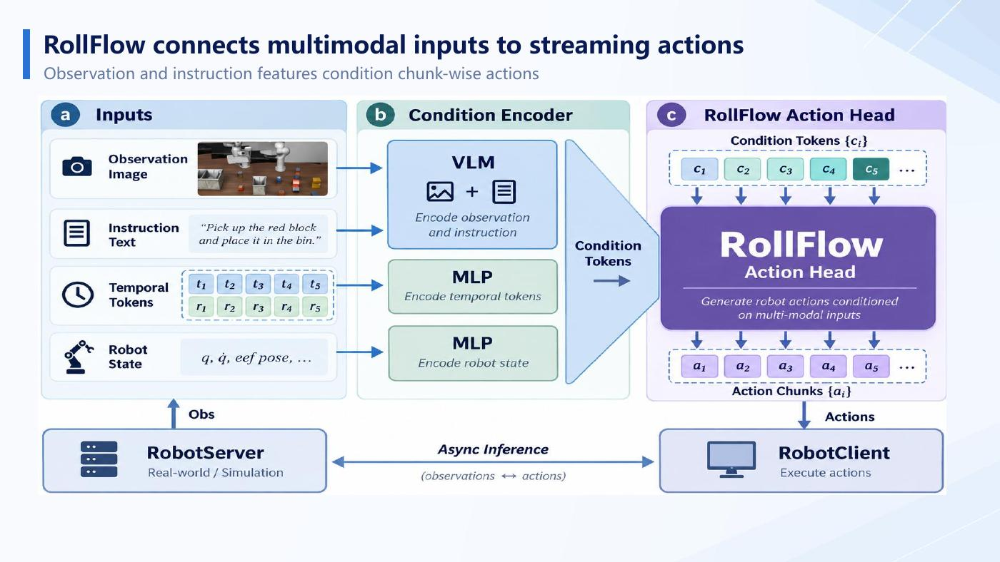
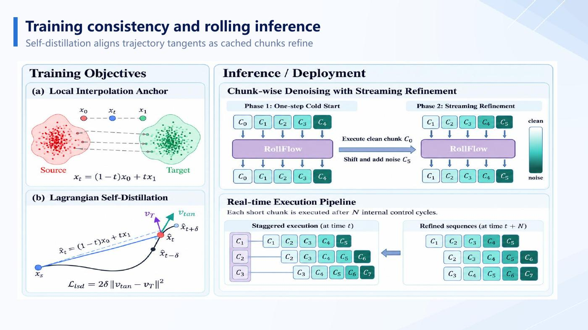
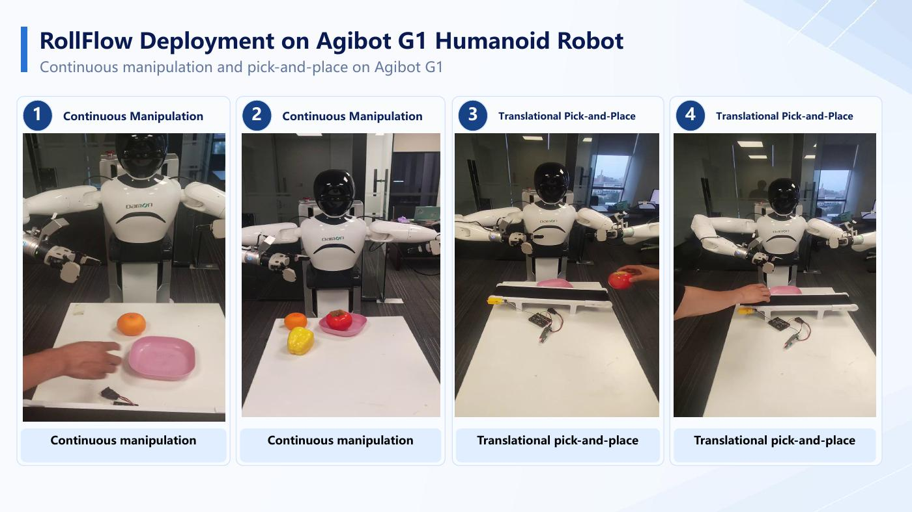

# RollFlow

**Rolling-Refined Flow Matching for High-Frequency Robotic Control**

A streaming action-generation research project built on the [StarVLA](https://github.com/starVLA/starVLA) codebase. RollFlow keeps a horizon of action chunks, refines that rolling window over control cycles, and executes the next chunk after each update. The training recipe can use ordinary flow matching alone or add optional Lagrangian self-distillation (LSD) for few-step inference.

  

## What this repository contains

- StarVLA action-head implementations for the original flow-matching baseline and RollFlow.
- A state-only Minari training and evaluation path for fast algorithm checks without a VLM.
- LIBERO and real-robot training/deployment examples, including an optional EVA integration.
- Diagnostics for separating the effects of rolling inference, time sampling, model changes and LSD.

RollFlow is an addition to StarVLA, not a replacement for the general StarVLA platform. The upstream project provides the broader VLA training and evaluation infrastructure; this repository focuses on the RollFlow method and its experiments.

## Method at a glance

  

The code supports three useful comparisons:

| Variant | Training objective | Inference |
|---|---|---|
| Original FM | Standard flow matching | Regenerate the action horizon using the baseline sampler |
| Rolling FM | Flow matching with RollFlow's grouped time sampling; LSD disabled | Keep and refine a rolling action window |
| Rolling FM + LSD | Rolling FM plus optional self-distillation | Evaluate instantaneous and interval-average velocity modes |

At inference, the rolling scheduler shifts the action window as chunks are executed and injects fresh noise at the tail. The pure-flow path is intended to retrofit streaming inference without adding a distillation objective. LSD is an optional training path intended to support more aggressive few-step generation; it is not required to use rolling inference.

The implementation details and configuration are in [rolling_meanflow.py](starVLA/model/modules/action_model/rolling_meanflow_matching_head/rolling_meanflow.py) and [GR00T_RollFlow_ActionHeader.py](starVLA/model/modules/action_model/GR00T_RollFlow_ActionHeader.py).

## Results reported in the supplied RollFlow v2 presentation

The overview PDF supplied with this release reports the following numbers. Exact checkpoints, full evaluation configurations and raw traces are not bundled here, so treat these as presentation-reported results rather than independently reproduced results from this repository.

| Benchmark setting | Decoder passes (RollFlow / baseline) | Success rate (%) | Action-decoding latency (ms) |
|---|---:|---:|---:|
| LIBERO, NFE 8 / 10 | 1 / 10 | 78.5 / 78.2 | 16.12 / 88.90 |
| MetaWorld, NFE 4 / 4, chunk size 8 | 1 / 4 | 98.3 / 98.0 | 2.45 / 7.01 |

The presentation compares one-pass rolling updates with iterative serial flow-matching inference. The reported decoding latency excludes the rest of the robot control stack; it should not be read as end-to-end camera-to-actuator latency.

  

## Current diagnostic status

A small state-only Reacher screen compared the three variants at horizon 32 and execution chunk 4. With one training seed and ten evaluation seeds, LSD instantaneous inference was close to rolling FM, while LSD average-velocity inference had worse replay fit and return at K=2/4/8. This is an early diagnostic, not a general performance claim; it shows that enabling LSD alone does not guarantee that average-velocity inference improves.

See the [Reacher report](docs/diagnostics/rollflow_minari_reacher_h32_c4_20261031.md) for settings, paired intervals and limitations. More independent training seeds and longer tasks are needed before drawing broad conclusions.

## Portable upgrade Skill

This repository includes [RollFlow Skill v1.0](skills/upgrade-rolling-flow/README.md) as a portable agent workflow, with reference kernels, configuration examples, original-source provenance, and a reproducible test bundle. Its report records 107 CPU tests and a synthetic joint-attention smoke example. It explicitly does not claim validation on a production VLA checkpoint, GPU mixed precision, simulation, asynchronous RTC, or a physical robot. Download the unchanged [ZIP release](releases/RollFlow_Skill_v1.0.zip) or browse the extracted source under `skills/upgrade-rolling-flow/`.

## Quick links

- [Portable RollFlow upgrade Skill v1.0](skills/upgrade-rolling-flow/README.md) — includes the agent instructions, reference kernels, configuration examples, tests and scope-limited validation report. The original distributable archive is [RollFlow_Skill_v1.0.zip](releases/RollFlow_Skill_v1.0.zip).
- [Minari state-only experiments](examples/simBenchmarks/Minari/README.md)
- [LIBERO RollFlow workflow](examples/simBenchmarks/LIBERO/README.md)
- [EVA deployment guide](docs/eva_deployment.md)
- [G2 asynchronous deployment guide](examples/deployment/eva/G2_ASYNC_DEPLOYMENT.md)
- [EVA deployment regression report](examples/deployment/eva/validation_report_20261014.md)
- [RollFlow diagnostic reports](docs/diagnostics/)

Start from the Minari guide for the fast state-only comparisons. For robot deployment, read the EVA guide and the robot-specific configuration before launching a policy server or client.

## Authors and upstream attribution

The supplied RollFlow v2 presentation lists Jungui Feng, Youguang Xue, Yanfeng Lu, Zeyu Gao, Xibo Ma, Kai Zhao and Ji Zhao, with affiliations to the Institute of Automation, Chinese Academy of Sciences, and Magine AI. Its cover states acceptance by *IEEE Robotics and Automation Letters*; final publication metadata and a DOI are not included in this repository yet.

This implementation builds on [StarVLA](https://github.com/starVLA/starVLA). Preserve the upstream notices and read the repository [LICENSE](LICENSE), which includes project-specific upstream attribution terms in addition to the MIT license text.

The upstream StarVLA citation metadata is preserved in [CITATION.cff](CITATION.cff). RollFlow publication metadata can be added when the final DOI is available.

## License

See [LICENSE](LICENSE) for the applicable terms and attribution requirements.
